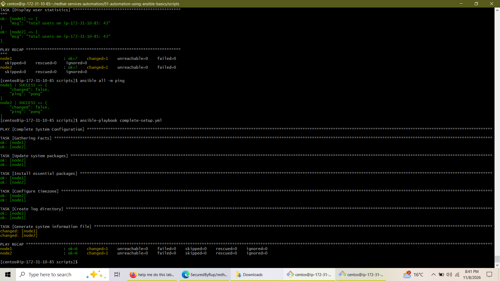
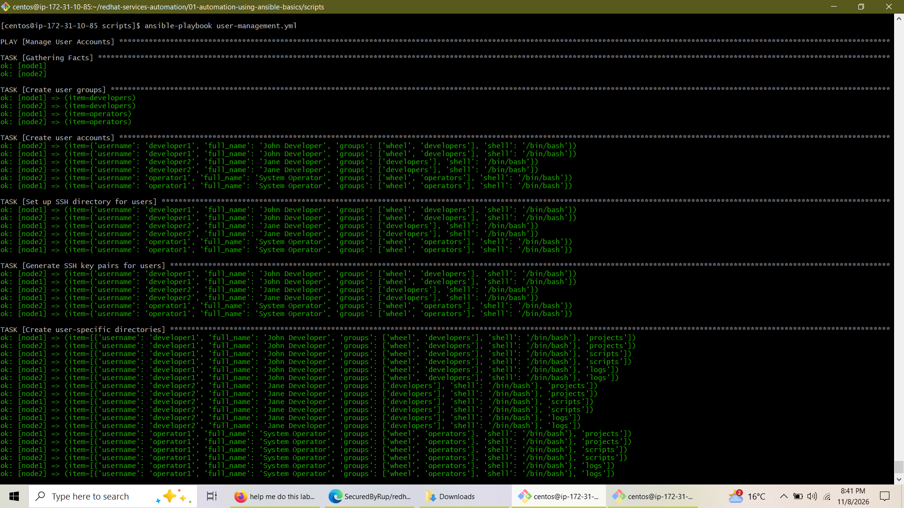
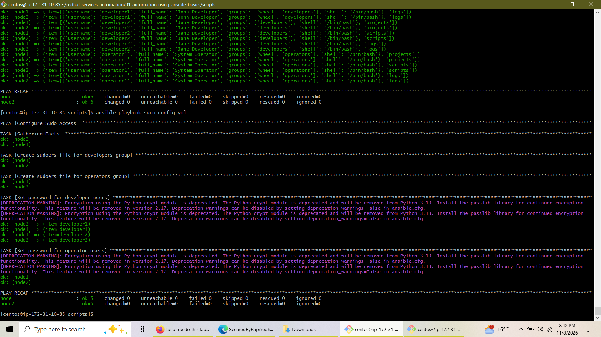
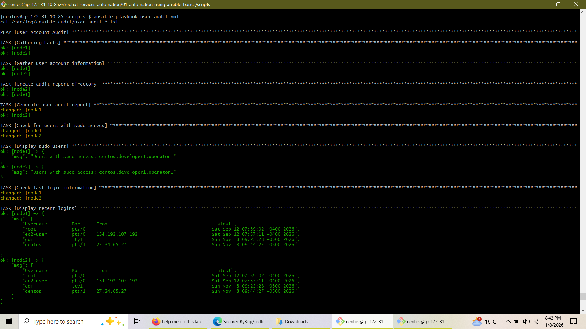
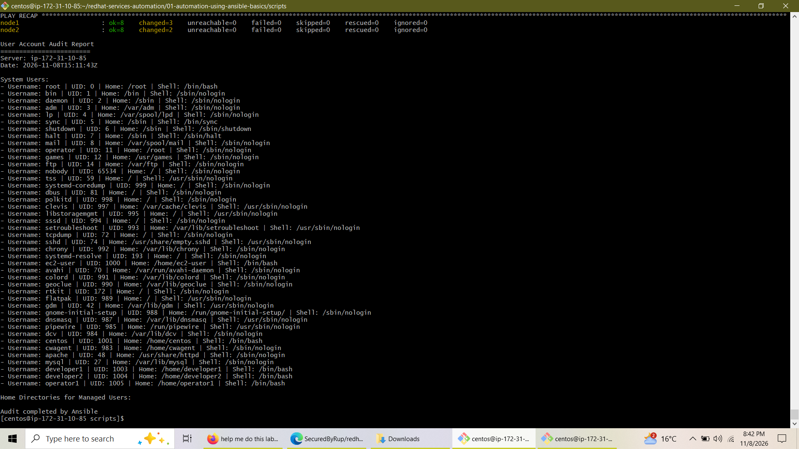
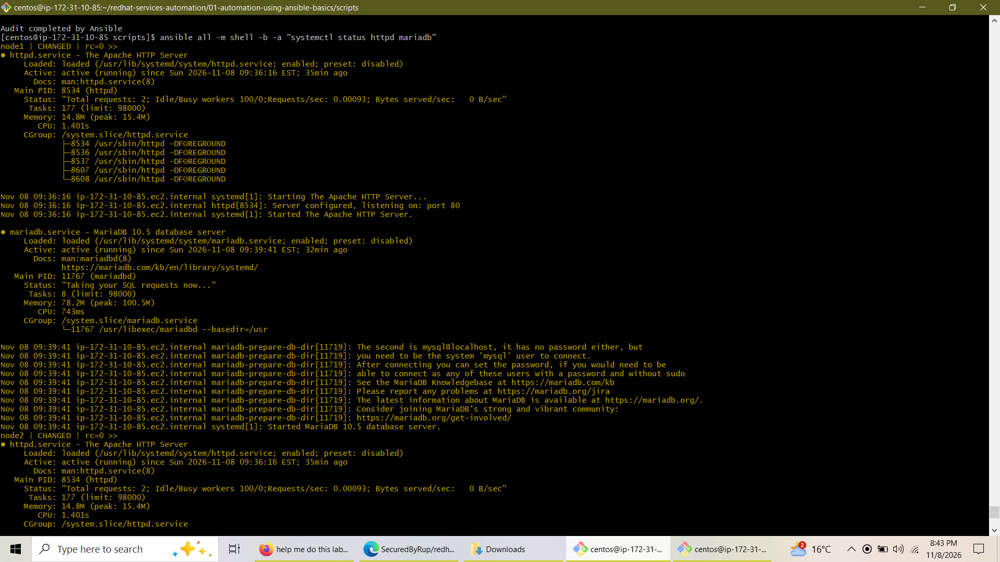
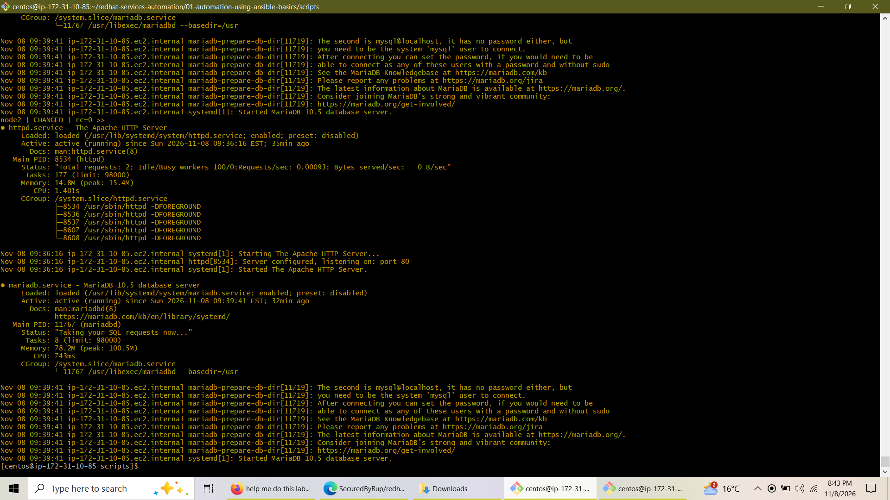

# Lab 1: Automation Using Ansible Basics

<p align="left">
  
  
  
  
  
  
</p>

## Overview
This repository contains the configuration playbooks, Jinja2 templates, and automation scripts developed for **Lab 1: Automation Using Ansible Basics**. The project establishes a robust, automated infrastructure management workflow across local managed nodes (`node1` and `node2`) running on **CentOS Stream 9**, utilizing **Ansible Core 2.14.18** via `ansible_connection=local`.

---

## Architecture & Project Structure
```text
~/redhat-services-automation/01-automation-using-ansible-basics/
└── scripts/
    ├── inventory
    ├── ansible.cfg
    ├── complete-setup.yml
    ├── webserver-setup.yml
    ├── database-setup.yml
    ├── user-management.yml
    ├── sudo-config.yml
    ├── user-audit.yml
    ├── user-cleanup.yml
    └── templates/
        ├── system-info.j2
        └── user-audit.j2
```

---

## Screenshot Mapping Reference

Before committing images to your repository, rename your screenshots according to the following mapping guide:

| Original Screenshot Name | Renamed Image File Path | Description / Context |
|---|---|---|
| `Screenshot (866).png` | `images/complete-setup-execution.png` | Shows ad-hoc ping verification & `complete-setup.yml` playbook execution. |
| `Screenshot (867).png` | `images/user-management-execution.png` | Shows `user-management.yml` creating user groups, accounts, and directory trees. |
| `Screenshot (868).png` | `images/sudo-config-execution.png` | Shows `sudo-config.yml` setting up sudoers permissions and user passwords. |
| `Screenshot (869).png` | `images/user-audit-execution.png` | Shows execution of `user-audit.yml` and output of sudo user checks. |
| `Screenshot (870).png` | `images/user-audit-report-output.png` | Shows generated `/var/log/ansible-audit/` user audit report. |
| `Screenshot (871).png` | `images/service-status-verification-1.png` | Verification of Apache HTTP Server and MariaDB services running on `node1`. |
| `Screenshot (872).png` | `images/service-status-verification-2.png` | Verification of Apache HTTP Server and MariaDB services running on `node2`. |

---

## Lab Execution & Implementation

### Task 1: Environment Setup & Ad-Hoc Validation
- Configured local inventory targeting `node1` and `node2` using local connections.
- Verified control node connectivity and successful command execution via Ansible ad-hoc commands (`ansible all -m ping`).



---

### Task 2: Core Infrastructure & Service Automation
- Deployed and configured **Apache HTTP Server** (`httpd`) and **MariaDB** database services across nodes.
- Automated package updates, timezone synchronization, directory creation, and system information templating using `complete-setup.yml`.

---

### Task 3: User Management, Sudo Policies & Auditing
- **User Provisioning (`user-management.yml`):** Created specialized security groups (`developers`, `operators`), provisioned user accounts (`developer1`, `developer2`, `operator1`), established home directories, generated SSH key pairs, and set up project/script/log workspaces.
- **Sudo Access Configuration (`sudo-config.yml`):** Implemented strict least-privilege role boundaries using `/etc/sudoers.d/` drop-in files with syntax validation (`visudo`) and securely hashed SHA-512 passwords.





- **Account Auditing (`user-audit.yml`):** Leveraged Jinja2 templating (`user-audit.j2`) to extract system passwd databases and output structured compliance audit logs into `/var/log/ansible-audit/`.





---

## Verification & Testing
Final service checks confirm that all target environments maintain active states for enterprise daemons, secure user permissions, and fully operational audit trails.





---

## Conclusion
Lab 1 successfully demonstrates core **Red Hat Ansible Automation** capabilities, transitioning manual administrative workflows into repeatable, idempotent playbooks. By enforcing structured user management, secure privilege escalation, and automated auditing, this project establishes a solid foundation for advanced enterprise cloud infrastructure management and DevOps pipelines.