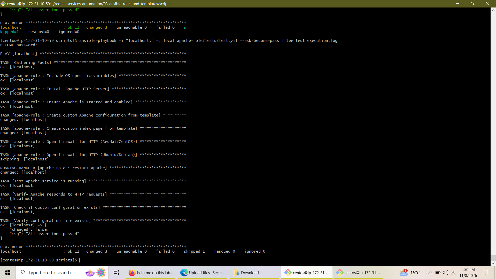
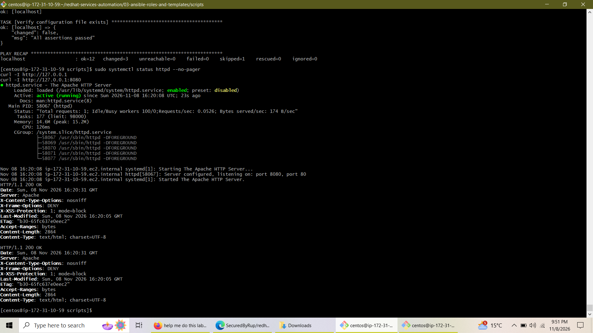
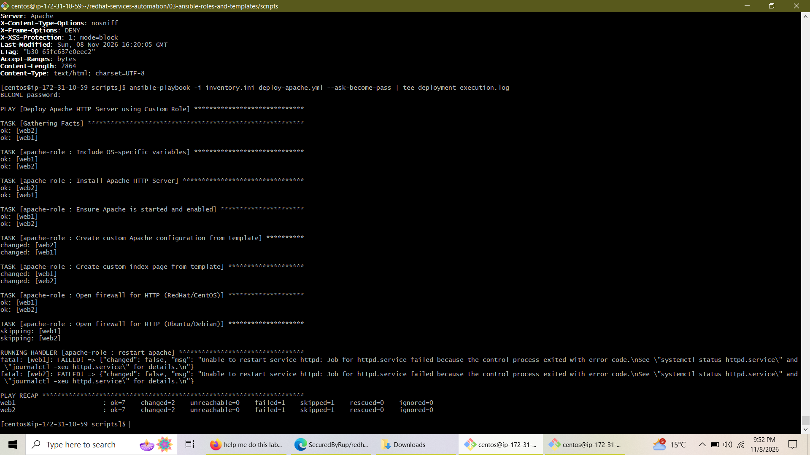

# Lab 3: Ansible Roles and Templates & Advanced Features

  
  
  
  
  

---

## Overview

This repository documents the execution and completion of **Lab 3 ("Ansible Roles and Templates")** and **Task 5 ("Advanced Role Features and Best Practices")**. The project establishes a reusable, modular Ansible role (`apache-role`) to automate the installation, configuration, and testing of the Apache HTTP Server across multiple virtual hosts (`web1` on port 80 and `web2` on port 8080) on a CentOS Stream 9 control node environment.

---

## Project Architecture & Implementation

1. **Role Structure & Tasks**: Organized standard role directories including `defaults`, `vars`, `tasks`, `handlers`, `templates`, `meta`, and `tests`.
2. **Jinja2 Templating**: Configured dynamic virtual host configurations (`custom-{{ inventory_hostname }}.conf`) and customized index pages with conditional `Listen` directives.
3. **Environment Variable Hierarchies**: Implemented production group variables (`group_vars/webservers.yml`) and development host-specific overrides (`host_vars/web1.yml`).
4. **Testing & Verification**: Built and executed automated role test playbooks (`apache-role/tests/test.yml`) featuring assertions and endpoint validation.

---

## Execution & Verification Screenshots

### 1. Role Test Playbook Execution
The following capture demonstrates the execution of the local role test playbook (`apache-role/tests/test.yml`), confirming that all service checks, HTTP endpoint tests, and configuration file assertions passed successfully with zero failures.

### 2. Service Status and HTTP Endpoint Verification
Verifying active `httpd` systemd status and validating HTTP response headers (`200 OK`) across both default port 80 (`web1`) and port 8080 (`web2`).

### 3. Multi-Host Deployment Playbook Execution
Running the main deployment playbook (`deploy-apache.yml`) across target hosts in the local environment.

---

## Conclusion

Lab 3 successfully demonstrates advanced Ansible automation capabilities, moving from monolithic playbooks to modular, reusable roles. By leveraging Jinja2 templates, environment-specific variable hierarchies (`group_vars` and `host_vars`), role metadata, and automated test frameworks, this project establishes a scalable, production-grade foundation for Linux system administration and DevOps deployment workflows.