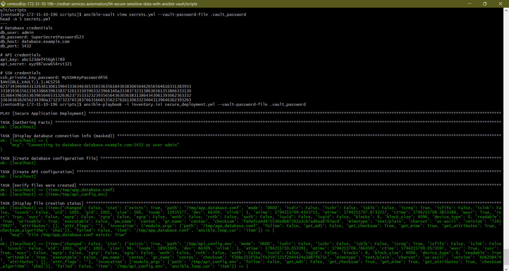
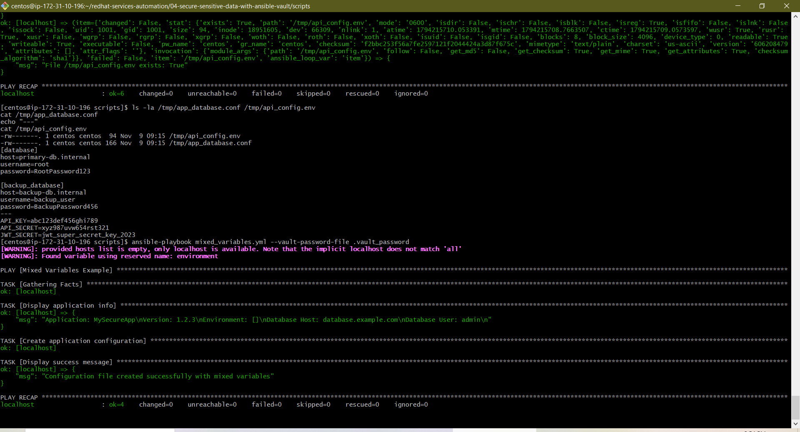
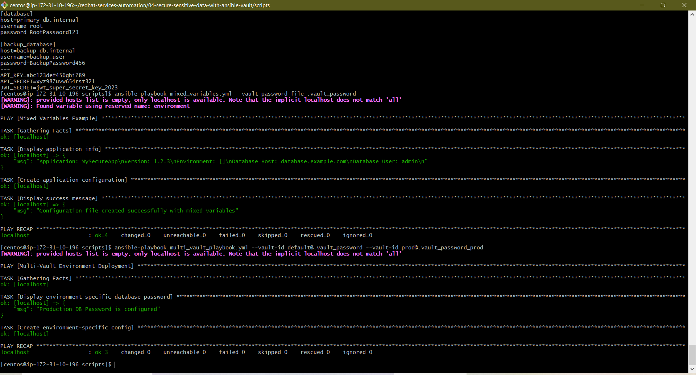

# Lab 4: Secure Sensitive Data with Ansible Vault

## Overview

This repository documents the execution and completion of **Lab 4 ("Secure Sensitive Data with Ansible Vault")**. The project demonstrates enterprise-grade techniques for encrypting, managing, and injecting sensitive data—such as database passwords, API credentials, and secret keys—into Ansible automation playbooks without exposing plain-text secrets in version control systems.

## Project Architecture & Implementation

1. **Vault Encryption Management**: Created and managed AES-256 encrypted configuration files (`secrets.yml` and `database_config.yml`) using `ansible-vault` commands and password files (`.vault_password`).
2. **Automated Playbook Integration**: Designed secure deployment playbooks (`secure_deployment.yml`) that dynamically decrypt vault variables during execution to provision secure local configuration files with strict file permissions (`0600`).
3. **Mixed Variable Patterns**: Developed playbooks (`mixed_variables.yml`) that cleanly combine plain-text application metadata with vault-encrypted database credentials.
4. **Multi-Vault Environments**: Implemented multi-vault ID strategies (`multi_vault_playbook.yml`) utilizing distinct encryption keys (`default` vs. `prod`) across environment tiers.
5. **Git Security Best Practices**: Enforced strict version control exclusions by isolating plaintext secrets and adding password files (`.vault_password*`) to `.gitignore`.

---

## Execution & Verification Screenshots

### 1. Vault File Decryption & Secure Deployment Playbook Execution
**Renamed File:** `images/Screenshot_Lab4_Deployment_Pass.png` *(Original: `Screenshot (884).png`)*

The screenshot below illustrates the verification of encrypted vault variables (`secrets.yml`), followed by the successful execution of `secure_deployment.yml` using `.vault_password`. The playbook successfully creates encrypted configuration outputs and verifies file existence with zero failures.

### 2. Decrypted Config Verification & Mixed Variables Playbook Execution
**Renamed File:** `images/Screenshot_Lab4_MixedVars_Pass.png` *(Original: `Screenshot (885).png`)*

This capture verifies that output files in `/tmp/` (`/tmp/app_database.conf` and `/tmp/api_config.env`) maintain strict `0600` permissions. It also demonstrates the execution of `mixed_variables.yml`, successfully combining plain-text application metadata with vault secrets.

### 3. Multi-Vault Environment Deployment Execution
**Renamed File:** `images/Screenshot_Lab4_MultiVault_Success.png` *(Original: `Screenshot (886).png`)*

The capture demonstrates advanced multi-vault playbook execution (`multi_vault_playbook.yml`), decrypting multiple secret files simultaneously across environment boundaries using explicit `--vault-id` flags (`default` and `prod`).

---

## Conclusion

Lab 4 demonstrates mastery over security standards in automated infrastructure management. By integrating Ansible Vault, password file automation, mixed variable handling, and multi-vault ID segregation, this project establishes a hardened pipeline for managing sensitive credentials across multi-environment deployments while adhering to DevSecOps best practices.